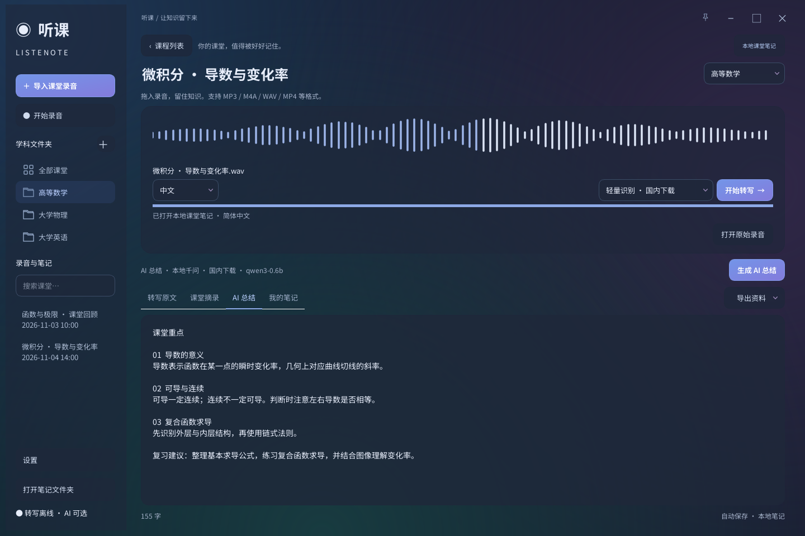
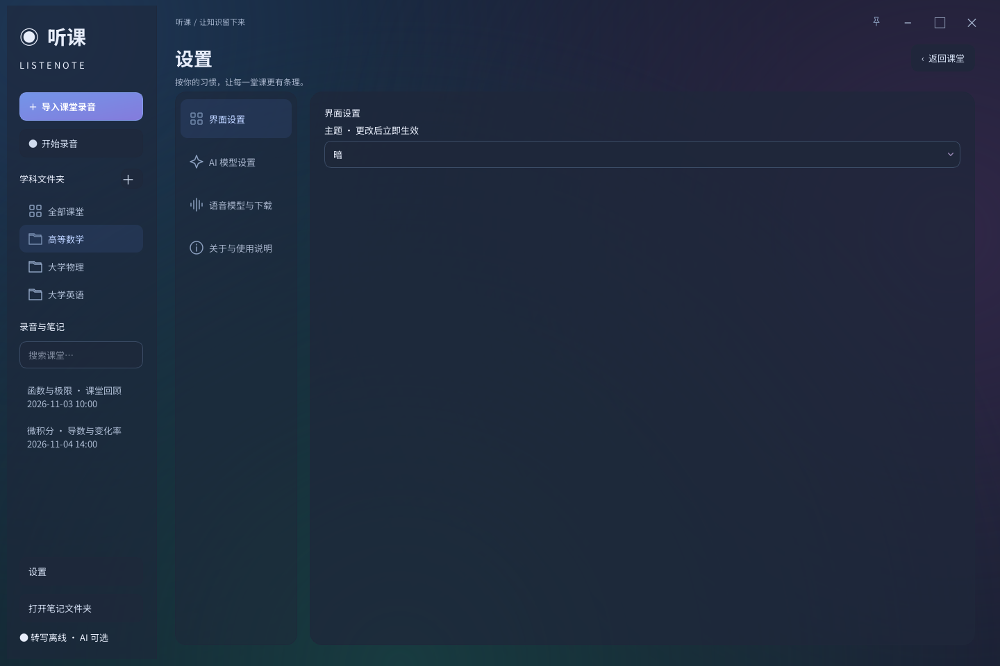

# 听课 Listenote 2.0

Windows 10/11 x64 课堂录音、离线转写、笔记与可选 AI 总结工具。


Listenote 2.0 实际界面，截图中的课堂内容为演示数据。

<details>
<summary>查看暗色主题与界面设置</summary>

暗色主题：



界面设置：支持亮、暗和跟随系统，“界面设置”位于设置列表第一项。



</details>

## 下载安装

前往 [Releases](https://github.com/Snowflake006/Listenote/releases/latest) 下载 `Listenote-Windows-x64-v2.0.0.zip`，完整解压到新文件夹，双击 `Listenote/听课.exe`。无需安装 Python。

2.0 使用轻量运行库，清理未使用的 Qt 开发工具、QML 和测试组件，采用 ZIP 最高压缩级别。安装包包含转写和本地 AI 的运行引擎；语音和 AI 模型通过软件内国内下载入口按需准备，模型下载后可以离线使用。首次使用需要联网下载模型，安装包不附带模型权重。

旧版用户请保留旧软件目录，将 2.0 解压到新目录运行。默认继续使用 `%LOCALAPPDATA%\Listenote` 中的课堂、录音和设置；建议升级前备份此目录。2.0 的依赖已改变，请勿使用旧版 AI 小补丁升级。

使用同一发布页的 `SHA256.txt` 校验下载完整性：

```powershell
Get-FileHash .\Listenote-Windows-x64-v2.0.0.zip -Algorithm SHA256
```

## 2.0 功能

- 亮、暗、跟随系统三种主题；设置中“界面设置”位于第一项。
- 圆角玻璃下拉和右键菜单，统一页面、按钮交互与切换动画。
- Windows 原生最大化、最小化及分屏处理；顶部别针切换窗口置顶。
- 任务栏显示 Listenote 名称和图标，右键提供开始、暂停、结束录制。开始录制需先确认课堂名称和学科，暂停指令不会重复切换为继续。
- 学科文件夹、课程列表、搜索、拖动分类，以及课程右键删除。删除的课堂归档到数据目录“已删除课堂”，外部原录音保留。
- 导入 MP3、M4A、WAV、MP4 等音视频，支持中文、英语与自动识别。
- 麦克风录音、暂停、标记重点；转写文字可编辑并自动保存。
- AI 总结支持内置本地千问、Ollama、自定义 API 和国内服务；长课堂自动分段整理。
- 单独导出课堂摘录、AI 总结或全部资料，支持 Word、PDF、TXT、Markdown；全部资料还支持转写 SRT。
- 更新检查加入缓存、冷却及 GitHub 官方发布页回退，减少检查受限。

## 首次准备模型

在“设置 → 语音模型与下载”下载轻量语音模型（约 148 MB），之后选择“轻量识别 · 国内下载”开始转写。轻量模型与旧版 large-v3-turbo 精度不同，请核对重要内容。原版高精度模式需要完整旧版运行环境和模型，2.0 精简包不附带这些组件。

在“设置 → AI 模型设置”选择内置本地千问，通过国内 ModelScope 下载模型，无需另外安装 Ollama。也可接入已运行的 Ollama，或填写自定义服务的 Base URL、API 密钥及模型名。远程 AI 只有在主动确认后发送当前课堂原文，服务商可能收费。密钥只保留在本次运行内。

课堂摘录是按时间、关键词提取的原文片段，不是大语言模型总结。AI 总结和识别结果可能出错，重要内容请回听核对。修改原文后，旧 AI 总结会提示可能过期。

## 数据与源码

数据默认位于 `%LOCALAPPDATA%\Listenote`。课堂资料按学科和课堂归档，包含原音频副本、完整 JSON、原文、课堂摘录、AI 总结及笔记；根目录 JSON 为兼容索引。外部原音频保留。

```text
Listenote/app/           界面、录音、转写、模型、主题与 Windows 集成
Listenote/app/version.py 共享版本号
Listenote/Launcher.cs    Windows 启动器源码
requirements-lite.txt   2.0 轻量运行依赖
scripts/build_lite.py    本地预览及精简打包
scripts/build_release.py 正式发布包入口
scripts/prepare_llama.py 固定版本本地 AI 引擎准备
```

开发时将轻量依赖安装到 `.lite-site`，准备 Python 3.12 x64 嵌入式运行环境到 `Listenote/runtime`，运行 `scripts/prepare_llama.py` 准备本地引擎，再运行 `python scripts/build_release.py`。发布目录 `.release` 需为空；产物在 `dist`，使用 Windows 自带解压工具即可打开。

双击 `本地预览.cmd` 使用 `.preview` 运行环境预览当前源码，预览数据存入 `.test-data/preview`，与正式数据分开。测试位于 `tests`，不需要真实 API 密钥。第三方许可证见安装包 `THIRD-PARTY.txt`、运行库许可文件与各包的 `.dist-info` 元数据。
