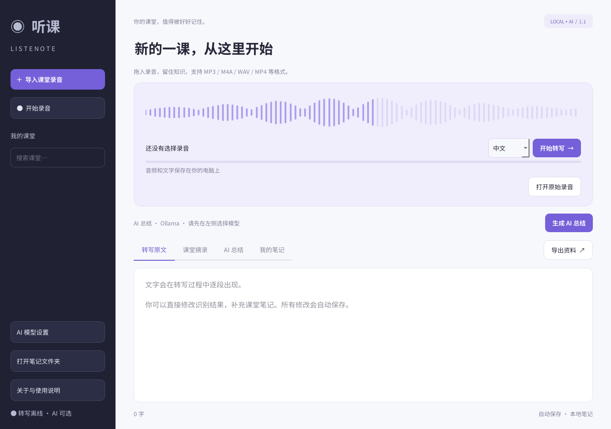

# 听课 Listenote

Windows 10/11 x64 课堂录音转写与笔记工具。使用 Whisper large-v3-turbo 在电脑上离线识别，AI 总结支持自选本地开源模型或自定义 API。



## 下载安装

前往 [Releases](https://github.com/Snowflake006/Listenote/releases/latest) 下载 `Listenote-Windows-x64-v1.1.0.zip`，完整解压后双击 `Listenote/听课.exe`。已有 1.0 版本可下载 `Listenote-AI-Update-v1.1.0.zip`，退出软件后解压到原软件包所在目录，覆盖 `Listenote` 文件夹中的同名文件。

软件包包含 Python 运行环境、CPU 推理依赖、模型和 FFmpeg，无需另装 Python。请保留全部文件，不要单独移动 EXE。建议至少 8 GB 内存（推荐 16 GB），约 4 GB 可用空间。

下载包的 SHA-256 校验值见 [SHA256.txt](SHA256.txt)。PowerShell 校验命令：

```powershell
Get-FileHash .\Listenote-Windows-x64-v1.1.0.zip -Algorithm SHA256
```

## 功能

- 导入 MP3、M4A、WAV、MP4 等音视频，支持中文、英语和自动识别。
- 麦克风录音、暂停和标记重点。
- 编辑并自动保存转写文字。
- 按时间和关键词提取课堂原文摘录。
- AI 总结：自选模型、自动分段整理长课堂、自定义总结要求、单独编辑和保存。
- 导出 Word、PDF、TXT、Markdown 和 SRT。

课堂摘录是原文提取，不是大语言模型总结。时间戳约按 25 秒分段，SRT 为片段级时间。识别结果可能出现错漏，重要内容请回听核对。

## AI 总结

转写完成后，在左侧打开 **AI 模型设置**，配置模型，再点击 **生成 AI 总结**。结果保存在独立的“AI 总结”标签页，并包含在 Word、PDF、TXT 和 Markdown 导出中；SRT 仍只包含原转写片段。

### 本地免费开源模型

1. 安装 [Ollama Windows 版](https://ollama.com/download/windows)。
2. 在终端执行 `ollama pull qwen3:4b` 下载 [Qwen3 4B](https://ollama.com/library/qwen3:4b)，也可以下载其他适合电脑配置的开源对话模型。
3. 保持 Ollama 运行，在软件中选择“本地开源模型 · Ollama”，地址使用 `http://localhost:11434`。
4. 点击“获取模型列表”，选择已下载的模型并保存。

总结模型需要单独下载，完整软件包仅内置语音识别模型。Ollama 默认地址上的本地推理无需按次 API 费用，速度及内存占用由所选模型和电脑配置决定。下载后的本地模型可离线使用；此模式不提供云端模型。

### 自己接入 API

选择“自定义 API”，填写服务商提供的 **Base URL**（例如 `https://你的服务地址/v1`）、**API 密钥**和**模型名称**。支持 Chat Completions 兼容接口；模型列表通过 `/models` 获取，服务不提供列表时可以手动输入模型名。也支持本机提供兼容接口的模型工具。

远程服务使用 HTTPS。点击总结时会先显示目标服务地址，确认后才发送当前课堂原文。费用取决于服务商。密钥仅在当前软件进程内保存，重启后需要重新输入；不会写入设置、课堂笔记或导出文件。

长原文会先分段总结，再合并所有分段摘要。生成失败、取消或模型输出被截断时保留原有总结。停止操作会在当前请求结束后生效；模型请求超时为 180 秒。修改原文后建议重新生成总结，导出时会标记旧总结可能过期。

笔记和录音默认存放在 `%LOCALAPPDATA%\Listenote`。导入的原录音保留在原位置，请不要移动或删除。更多信息见 [使用说明](Listenote/使用说明.txt)。

## 源码结构

```text
Listenote/
  app/main.py        界面与业务逻辑
  app/startup.py     启动入口和错误日志
  app/ai_summary.py  模型接口与长文本总结
  app/ai_ui.py       模型设置与后台任务
  app/fonts/         字体及许可证
  Launcher.cs        Windows 启动器源码
  models/whisper/    模型配置与分词器（权重在离线软件包中）
  tools/             FFmpeg 许可证（可执行文件在离线软件包中）
  THIRD-PARTY.txt    第三方组件说明
```

Git 仓库不包含体积较大的 Python 运行环境、模型权重和 FFmpeg 可执行文件；完整离线软件包通过 Releases 分发。

## 从源码运行

需要 Windows x64 与 Python 3.12。最直接的方式是完整解压 Release 软件包，将本仓库中的 `Listenote/app` 源码覆盖到解压目录对应位置，再运行启动器。

也可以自行准备依赖：

```powershell
py -3.12 -m venv .venv
.\.venv\Scripts\python.exe -m pip install torch==2.7.1 --index-url https://download.pytorch.org/whl/cpu
.\.venv\Scripts\python.exe -m pip install -r requirements.txt
```

将 [Whisper large-v3-turbo](https://huggingface.co/openai/whisper-large-v3-turbo) 的 `model.safetensors` 放入 `Listenote/models/whisper/`，将 FFmpeg 放入 `Listenote/tools/ffmpeg.exe`，然后运行：

```powershell
.\.venv\Scripts\python.exe Listenote/app/main.py
```

应用默认启用离线模式，运行前需要准备好模型。第三方组件许可证见 [THIRD-PARTY.txt](Listenote/THIRD-PARTY.txt) 及相应目录。

## 开发验证

`python tests/test_ai.py` 使用临时本机 HTTP 服务测试两种模型接口、长文本覆盖、取消、错误处理、Qt 保存和导出流程，不需要真实 API 密钥。此测试使用模拟模型回复，不评估真实模型的总结质量。
